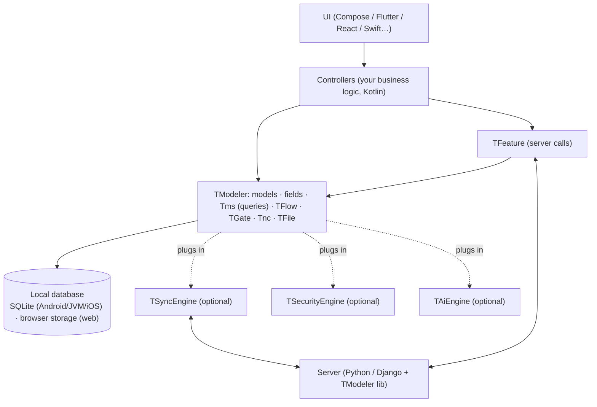

# TModeler — Getting Started Guide

> **TModeler** is a data design and management technology for **offline-first** applications: you describe your
> data once (Kotlin models), and TModeler takes care of the local database, relations, queries, paginated
> lists, real-time notifications and (optionally) server synchronization and encryption.
>
> This document is **the starting point**. Read it in order. After that, one document per platform
> covers what is specific to each one:
>
> | Platform | Document |
> |---|---|
> | Native Android (Kotlin / Java) | [`02-android.md`](02-android.md) |
> | Flutter | [`03-flutter.md`](03-flutter.md) |
> | React (web) | [`04-react.md`](04-react.md) |
> | JVM (desktop / server) | [`05-jvm.md`](05-jvm.md) |
> | iOS | [`06-ios.md`](06-ios.md) |
>
> You do not need to read the TModeler source code: everything required to install,
> use and troubleshoot it is here.

## Table of contents

1. [Philosophy](#1-philosophy)
2. [Architecture](#2-architecture)
3. [Platforms and support status](#3-platforms-and-support-status)
4. [Prerequisites and IDE](#4-prerequisites-and-ide)
5. [Installation](#5-installation)
6. [First start: initializing TModeler](#6-first-start-initializing-tmodeler)
7. [Defining models](#7-defining-models)
8. [Field types](#8-field-types)
9. [Relations](#9-relations)
10. [Saving, reading, updating, deleting](#10-saving-reading-updating-deleting)
11. [Querying data](#11-querying-data)
12. [Paginated lists: `TFlow`](#12-paginated-lists-tflow)
13. [Threads: `TGate`](#13-threads-tgate)
14. [Files and media](#14-files-and-media)
15. [Features: one server call = one `TFeature`](#15-features-one-server-call--one-tfeature)
16. [Instant notifications: `Tnc`](#16-instant-notifications-tnc)
17. [Engines: `TSyncEngine`, `TSecurityEngine` and `TAiEngine`](#17-engines-tsyncengine-tsecurityengine-and-taiengine)
18. [Server side (Python / Django)](#18-server-side-python--django)
19. [Designing an offline-first app](#19-designing-an-offline-first-app)
20. [Known limitations per platform](#20-known-limitations-per-platform)
21. [Troubleshooting](#21-troubleshooting)
22. [Quick reference](#22-quick-reference)

---

## 1. Philosophy

1. **The model is the source of truth.** A Kotlin class describes a table, its fields and its relations.
   No SQL to write, no DAO, no JSON mapper.
2. **The app is centered on local data, not on the server.** You always display what is
   already in the local database, immediately; a network refresh happens **in the background** and updates
   the screen if there is anything new. Offline, everything works.
3. **One business logic, several user interfaces.** The logic (models, controllers, features) is written once
   in Kotlin Multiplatform. The UI — Compose, Flutter, React… — is **passive**: it displays and
   forwards the user's actions, nothing else.
4. **One server call = one Feature.** An operation that touches the server (initialize, refresh, create…)
   is a `TFeature` class on the client side, which has a twin on the server side.
5. **Extras are optional.** Synchronization, security (encryption) and artificial intelligence are pluggable
   *engines* (`TSyncEngine`, `TSecurityEngine`, `TAiEngine`). TModeler works without them.
6. **TModeler is the only public face.** You only write code against TModeler.

---

## 2. Architecture



| Component | Role |
|---|---|
| **Model** (`TModel`) | A table: its fields and its relations |
| **Field** (`TextField`, `IntField`, `ModelField`…) | A typed column |
| **`Tms`** | A model's "manager": save, read, query |
| **`TFlow`** | Observable paginated list (list screens) |
| **`TGate`** | Execution on the right thread (data / background / main) |
| **`TFeature`** | A client ↔ server operation |
| **`Tnc`** | Instant notifications: WebSocket and push (FCM) |
| **`TFile`** | Files and media, uniformly across all platforms |
| **`TSyncEngine`** | *(optional)* server synchronization engine |
| **`TSecurityEngine`** | *(optional)* security (encryption) engine |
| **`TAiEngine`** | *(optional)* artificial intelligence engine |

**Golden rule of the architecture**: the UI has no SQL, no business rules, and no direct access to models.
It talks to a *bridge* that talks to the Kotlin controllers. The bridge is detailed in the Flutter and React
documents; in native Android, it is your `ViewModel`.

---

## 3. Platforms and support status

| Platform | Kotlin target | Local database | Status |
|---|---|---|---|
| Android | `android` | SQLite (+ SpatiaLite) | ✅ complete |
| JVM | `jvm` | SQLite (JDBC) | ✅ complete |
| Web | `wasmJs` | lightweight engine on browser storage | ✅ functional, [limitations](#20-known-limitations-per-platform) |
| iOS | `iosArm64`, `iosSimulatorArm64`, `iosX64` | SQLite (driver present) | 🚧 in progress, see [`06-ios.md`](06-ios.md) |

---

## 4. Prerequisites and IDE

### 4.1 Recommended IDE

| Need | IDE |
|---|---|
| **Native Android**, Flutter (Android part), JVM, TModeler in general | **Android Studio** (recent version, Koala or later) or **IntelliJ IDEA** — with the Kotlin plugin (included) |
| **Web / React** | **VS Code** (TypeScript, ESLint) for the React part, **IntelliJ IDEA / Android Studio** for the Kotlin/Wasm part |
| **Flutter** | **Android Studio** or **VS Code** with the *Flutter* and *Dart* extensions, plus Android Studio for the native Kotlin part |
| **iOS** | **Xcode** (macOS required) + Android Studio / IntelliJ for the shared Kotlin code |

> Choose **Android Studio** if you are unsure: it covers Android, JVM and editing the shared Kotlin.

### 4.2 Software to install

| Tool | Version | Why |
|---|---|---|
| **JDK** | **17** (21 accepted) | Build the Gradle project |
| **Gradle** | 8.x (through your project's `gradlew` *wrapper*; the sample app uses 8.14) | Build |
| **Kotlin** | **1.9.23** for the Kotlin/Wasm and Multiplatform modules; Android: 1.9.x or 2.1.x accepted | Language |
| **Android SDK** | API 34 or later; `minSdk` **21** minimum | Android |
| **Node.js** | 18 or later (LTS) | Web / React |
| **Flutter SDK** | Dart ≥ 3.x (the sample uses `sdk: ^3.11.0`) | Flutter |
| **Xcode** | recent | iOS |
| **Python** | 3.10 or later | Server |

Check:

```bash
java -version      # 17 or 21
node -v            # web only
flutter --version  # Flutter only
python --version   # server only
```

Set `JAVA_HOME` to the installed JDK if Gradle cannot find it.

> **Disk space**: Gradle, Kotlin/Native and the Maven caches are large. If your system disk is
> limited, move them before the first build:
> `GRADLE_USER_HOME`, `KONAN_DATA_DIR` (Kotlin/Native), `PUB_CACHE` (Flutter) and the
> `-Dmaven.repo.local=<folder>` option for the local Maven repository.

---

## 5. Installation

### 5.1 Artifact coordinates

| Artifact | Coordinates (group : name : version) | Used by |
|---|---|---|
| TModeler (multiplatform) | `co.tamboai:TModeler:1.0.1` | any Kotlin Multiplatform / JVM / web project |
| TModeler JVM | `co.tamboai:TModeler-jvm:1.0.1` | resolved automatically on JVM |
| TModeler Android | `co.tamboai:TModeler-android:1.0.1` | resolved automatically on Android |
| TModeler Web (wasm) | `co.tamboai:TModeler-wasm-js:1.0.1` | resolved automatically on wasmJs |
| Model registry generator (web) | `co.tamboai:tmodeler-ksp:1.0.1` | web projects (KSP plugin) |

You only declare `co.tamboai:TModeler:<version>`: Gradle picks the variant for the target platform.

### 5.2 Where to find the lib: Maven Central

TModeler is published on **Maven Central** under the group `co.tamboai`: nothing to install, nothing to
download by hand. Declaring `mavenCentral()` in your repositories is enough (§5.3).

Building from the sources (contributors only): publish into your machine's local Maven repository, then add
`mavenLocal()` **before** `mavenCentral()` in the consuming project.

```bash
# at the root of the TModeler project (tmodeler-kmp)
./gradlew :shared:publishToMavenLocal :tmodeler-ksp:publishMavenPublicationToMavenLocal
```

On Windows: `gradlew.bat …`. For another location: `-Dmaven.repo.local=D:\m2`; declare that same folder in the
consuming project (`maven { url = uri("D:/m2") }`).

### 5.3 Repositories to declare in your project

In the root `build.gradle.kts` (Android / JVM) or the module (web):

```kotlin
allprojects {
    repositories {
        google()
        mavenCentral()                                 // TModeler (co.tamboai)
        maven { url = uri("https://www.jitpack.io") }  // transitive dependency on Android (SpatiaLite)
    }
}
```

### 5.4 Dependencies

**Android** (`app/build.gradle.kts`):

```kotlin
dependencies {
    implementation("co.tamboai:TModeler:1.0.1")
    implementation("org.jetbrains.kotlinx:kotlinx-serialization-json:1.6.3")
    implementation("org.jetbrains.kotlinx:kotlinx-datetime:0.5.0")
    implementation("com.squareup.okhttp3:okhttp:4.12.0")

    // Push notifications (FCM) — only if you use push
    implementation(platform("com.google.firebase:firebase-bom:33.7.0"))
    implementation("com.google.firebase:firebase-messaging")
}
```

**JVM**: see [`05-jvm.md`](05-jvm.md). **Web**: see [`04-react.md`](04-react.md) (KSP plugin to add).

### 5.5 Mandatory compiler option

TModeler uses Kotlin's *context receivers*. **Every module that calls the TModeler API** must enable:

```kotlin
// Android (app module)
android { kotlinOptions { freeCompilerArgs += listOf("-Xcontext-receivers") } }

// Multiplatform / JVM
kotlin { compilerOptions { freeCompilerArgs.add("-Xcontext-receivers") } }
```

Without this option: compilation errors on `TGate.data { … }`, `.save { … }`, `.lazy()…`.

### 5.6 Gradle build and sync

1. Open the project in **Android Studio** (or IntelliJ IDEA).
2. Let the IDE run **Gradle Sync** (or: *File → Sync Project with Gradle Files*). From the command line:
   `./gradlew --refresh-dependencies help`.
3. If the sync fails on `co.tamboai:TModeler`, see [Troubleshooting](#21-troubleshooting): usually, `mavenCentral()` is
   not declared in the repositories.
4. Build: `./gradlew assembleDebug` (Android), `./gradlew build` (JVM).

> After any TModeler version update: change the version number in your dependencies, then
> *Sync*, then *Build → Clean Project* if the IDE keeps old classes.

### 5.7 Where does the installation end?

If your project compiles with `import ai.tambo.tmodeler.*`: **TModeler is installed**. Move on to the
next section.

---

## 6. First start: initializing TModeler

TModeler must be initialized **only once, when the process starts**, before any model is used.
On Android, that is the `Application` class.

```kotlin
import ai.tambo.tmodeler.db.Tdb
import ai.tambo.tmodeler.modeler.TModeler

TModeler.start()
    .connect(
        Tdb.Builder()
            .type(Tdb.Type.SQLITE)             // SQLite database
            .context(Tcontext(this))           // Android only: the Context
            .dbDir("db/")                      // database folder
            .dbName("MonApp-Main-1")           // database name
            .accept(User().clazz().getPackage())   // each package that contains models
            .start()!!
    )
```

Each `.accept(<package>)` call declares a **model package**: all the `TModel`s in that package
are attached to this database. Pass it any model from the package (`Message().clazz().getPackage()`).

`TModeler` options (chainable, before `.connect(...)`):

| Method | Role |
|---|---|
| `.synchronization(engine)` | Plugs in a synchronization engine → [§17](#17-engines-tsyncengine-tsecurityengine-and-taiengine) |
| `.security(engine)` | Plugs in a security engine (`TSecurityEngine`) → [§17](#17-engines-tsyncengine-tsecurityengine-and-taiengine) |
| `.notifications { … }` | Configures `Tnc` (WebSocket, push) → [§16](#16-instant-notifications-tnc) |
| `.connect(db)` | Opens the database; **call it last** |
| `.dbReady { … }` | Callback invoked when the database is ready |

`Tdb.Builder` options:

| Method | Role |
|---|---|
| `.type(Tdb.Type.SQLITE)` | Database type |
| `.context(x)` | Platform context (Android: `Tcontext(applicationContext)`) |
| `.dbDir(path)` / `.dbName(name)` | Location and name |
| `.accept(package)` | Model package to attach (repeatable) |
| `.server(config)` | Server configuration (see below) |
| `.autoServe(true)` | Automatic upload to the server on every save *(if a sync engine is plugged in)* |
| `.start()` | Builds the database (returns `null` on failure) |

### Server configuration

If the app talks to a server, provide a configuration (the class is supplied by the installed sync
engine — [§17](#17-engines-tsyncengine-tsecurityengine-and-taiengine)):

```kotlin
val config = TServerConfig()
    .baseServerHost("https://api.example.com")  // server URL
    .baseServerMediaHost("media")               // media sub-path
    .baseLocalMediaDir("media")                 // local media folder
    .baseLocalTmpDir("tmp")                     // local temporary folder
    .autoSync(false)                            // no global automatic sync
    .supportsSpatial(false)                     // SpatiaLite not required
```

Without a server (100% local app, tests), the base configuration is enough:
`.server(TServerConfigBase())` and no engine.

### After connecting: `commit()`

Once the database is connected, create your models' tables:

```kotlin
User.tms.commit()
Message.tms.commit()
```

(`commit()` creates the table if it does not exist. It can be called on every start.)

---

## 7. Defining models

A model is a class that **extends `TModel<MyClass>`**. Each column is a `var` whose value is a
*field* (`TextField()`, `IntField()`…).

```kotlin
package com.monapp.models

import ai.tambo.tmodeler.field.common.TextField
import ai.tambo.tmodeler.field.advanced.BoolField
import ai.tambo.tmodeler.model.TModel
import ai.tambo.tmodeler.model.TMignore
import ai.tambo.tmodeler.ms.Tms

class User : TModel<User>() {

    // 1) The fields (columns)
    var username = TextField()
    var phone    = TextField().unique()
    var verified = BoolField().default(false)

    // 2) Convenient accessors for the value
    @TMignore var username_ by username
    @TMignore var phone_    by phone
    @TMignore var verified_ by verified

    // 3) The model's manager
    companion object {
        val tms by lazy { Tms(User::class) }
    }
}
```

### Naming rules — essential to know

| Syntax | Meaning |
|---|---|
| `var username = TextField()` | **The field**: an object describing the column. Used in queries: `u.username eq "x"` |
| `@TMignore var username_ by username` | **The field's value**: `user.username_ = "alice"`, `println(user.username_)` |
| `@TMignore` | Indicates that this `var` is **not** a column (it is just an accessor). **Mandatory** on every `xxx_` |
| `companion object { val tms … }` | The manager: `User.tms` |

Convention: *field* without an underscore, *value* with a trailing underscore.

### Automatically provided columns

Every `TModel` already has:

| Field | Value | Role |
|---|---|---|
| `_id` | `_id_` | **Local** identifier (primary key, auto-incremented) |
| `id` | `id_` | **Server** identifier (unique). Equals "not served" until the server has assigned it |

When you query an object received from the server, use `id`; for the local insertion order, use `_id`.

### Table name

The table name is derived from the model's name and its package. Two models with the same name in two different
packages do not get mixed up.

### Rules

- A `TModel` must have a no-argument constructor.
- All "business" fields are non-null `var`s (`TextField()`, never `TextField?`).
- Ordinary Kotlin inheritance: an abstract class can carry common fields.
- Generic models are not supported on the web (no factory is generated).
- Changing a model's structure (adding/removing a field) changes the local schema: plan for the migration
  (see [§21](#21-troubleshooting)).

### Persisting app state: everything is a model

Anything that must survive a restart (current user, active conversation, draft, preferences,
cursors, "configured" flags) **must be a TModeler model** — never hand-written `SharedPreferences` or
`localStorage`. Example: a `Session` model with `currentUser`, `activeConversation`.

---

## 8. Field types

Every field is typed. The corresponding Kotlin value is indicated.

### 8.1 Scalars

| Field | Kotlin value | Example |
|---|---|---|
| `TextField` | `String` | `var title = TextField()` |
| `IntField` | `Long` | `var count = IntField().default(0)` |
| `FloatField` | `Double` | `var score = FloatField()` |
| `BoolField` | `Boolean` | `var active = BoolField().default(true)` |
| `TimeField` | `kotlinx.datetime.LocalDateTime` | `var createdAt = TimeField()` |
| `EnumField<E>` | one `enum` value | `var status = EnumField(Status.values()).default(Status.NEW)` |
| `EnumsField<E>` | several values of an `enum` | `var roles = EnumsField(Role.values())` |
| `JsonField` | `JsonElement` (kotlinx.serialization) | `var payload = JsonField()` |
| `GeoField` | `TGeo` (geographic point) | `var position = GeoField()` |

Imports: `ai.tambo.tmodeler.field.common.*` (`TextField`, `IntField`, `FloatField`) and
`ai.tambo.tmodeler.field.advanced.*` (`BoolField`, `TimeField`, `EnumField`, `ModelField`, `ListField`, …).

### 8.2 Relations

| Field | Role |
|---|---|
| `ModelField(Other::class)` | References **one** object (many-to-one, one-to-one) |
| `ListField(Other::class)` | References **a list** of objects (one-to-many, many-to-many) |

Details in [§9](#9-relations).

### 8.3 Files and media

| Field | Content |
|---|---|
| `FileField` | any file (`TFile`) |
| `ImageField` | an image |
| `AudioField` | a sound |
| `VideoField` | a video |
| `DocField` | a document |

These fields offer options: `maxDuration(seconds)`, `maxWidth(px)`, `maxHeight(px)`. Package:
`ai.tambo.tmodeler.field.media.*`.

### 8.4 Secure fields

`SecureTextField`, `SecureIntField`, `SecureFloatField`: same usage as their equivalents, but their
content is protected by the security engine (`TSecurityEngine`, [§17](#17-engines-tsyncengine-tsecurityengine-and-taiengine)).
With no engine installed, they behave like normal fields.

### 8.5 Common options (chainable)

| Option | Effect |
|---|---|
| `.default(value)` | Default value |
| `.nullable()` / `.notNull()` | Allows / forbids `null` |
| `.unique()` | Uniqueness constraint |
| `.primaryKey()` / `.autoIncrement()` | Reserved for keys (already defined by `_id`) |

```kotlin
var email = TextField().unique().notNull()
var level = IntField().default(1)
```

---

## 9. Relations

### 9.1 Declaring

```kotlin
class Message : TModel<Message>() {
    var messaging = ModelField(Messaging::class)   // a message belongs to a conversation
    var creator   = ModelField(Messager::class)    // an author
    var content   = TextField()
    var medias    = ListField(Media::class)        // several media items

    @TMignore var messaging_ by messaging
    @TMignore var creator_   by creator
    @TMignore var content_   by content
    @TMignore var medias_    by medias

    companion object { val tms by lazy { Tms(Message::class) } }
}
```

### 9.2 Using

```kotlin
message.creator_ = author              // assign
val name = message.creator_.name_      // read through the relation
message.medias_.add(image)             // add to the list
```

Saving the message also saves the links to its relations.

### 9.3 Unresolved reference ≠ crash

A relation can point to an object that has not been received yet (partial synchronization, orphan row).
**Check `available()`** before dereferencing:

```kotlin
if (message.creator.available()) {
    val name = message.creator_.name_
}
```

Avoid `try/catch` on hot paths: prefer `available()` / `exists()`.

### 9.4 Deep resolution

By default, queries and `TFlow` load relations in depth (linked objects of linked objects).
To disable it (very heavy lists):

```kotlin
Message.tms.deepLinkResolve(false)   // on a manager
flow.disableDeepLink()               // on a TFlow
```

---

## 10. Saving, reading, updating, deleting

> Data operations (`save()`, `update()`, `delete()`, `Tms.all()`, …) require the **data context**
> `TmsScope`, which guarantees that you are on the right thread. There are two ways to provide it, detailed in
> [§13](#13-threads-tgate): call within a `TGate.data { … }` block, or declare your function with
> `context(TmsScope)`.
> Import the extensions: `ai.tambo.tmodeler.ms.ext.*` and `ai.tambo.tmodeler.field.operation.*`.

### 10.1 Create / save

```kotlin
TGate.data {
    val u = User()
    u.username_ = "alice"
    u.phone_ = "+22500000000"
    u.save()                     // saves (creates or updates) — returns an integer
}
```

Block variant:

```kotlin
TGate.data {
    User().save {                // fields are set inside the block
        username = "alice"
        verified = true
    }
}
```

On the manager (several objects at once):

```kotlin
User.tms.create(u1, u2)
User.tms.create(listOf(u1, u2))
User.tms.update(u1)
User.tms.save(u1, u2)
```

### 10.2 Read

```kotlin
TGate.data {
    val all       = User.tms.all()             // all objects (avoid for large volumes: prefer TFlow)
    val first     = User.tms.first()
    val last      = User.tms.last()
    val byKey     = User.tms.get(5L)           // by local _id
    val byId      = User.tms.getById(42L)      // by server id
    val several   = User.tms.getByIds(listOf(1L, 2L))
    val total     = User.tms.size()
    val exists    = User.tms.exists()          // does the table exist
}
```

### 10.3 Update

```kotlin
TGate.data {
    val u = User.tms.getById(42L)
    u.verified_ = true
    u.update()
}
```

### 10.4 Delete

```kotlin
TGate.data {
    u.delete()           // deletes the object
    User.tms.clear()     // empties the table
}
```

### 10.5 Send to the server (if a sync engine is plugged in)

```kotlin
u.serve { saved -> /* server-side result */ }             // sends
u.serveCreate { saved -> … }                              // creates on the server
u.serveUpdate { saved -> … }                              // updates on the server
u.refresh { fresh -> … }                                  // re-reads from the server
u.isServed()                                              // has the server assigned it an id?
```

See [§15](#15-features-one-server-call--one-tfeature) for grouped operations (Features).

### 10.6 Observe changes

A manager or a model accepts callbacks: `onUpdate`, `onDelete`, `onChange`, `onCommitted`, `onEmit`.
To display lists that update themselves, use `TFlow` instead ([§12](#12-paginated-lists-tflow)).

---

## 11. Querying data

### 11.1 Anatomy of a query

```kotlin
TGate.data {
    val t = User.tms.lambda                                  // "t" represents the table in the query

    val results = User.tms
        .with(t)                                              // which table(s)
        .lazy()                                               // query mode (required before filter)
        .filter((t.verified eq true) and (t.username like "oli%"))   // condition
        .order(-t._id)                                        // sort: - descending, + ascending
        .sub(25, 0)                                           // 25 results starting from 0
        .build()                                              // executes → list
}
```

`.build()` returns a list of objects (`Tlist<User>`).

### 11.2 Short version

```kotlin
val latest = Message.tms.build {
    filter(it.messaging eq conversation).order(-it._id).sub(20)
}
```

### 11.3 Operators

| Operator | Example | Meaning |
|---|---|---|
| `eq` | `t.name eq "x"` | equal |
| `ne` | `t.id ne null` | not equal |
| `gt` `ge` `lt` `le` | `t.score gt 10.0` | comparisons |
| `like` | `t.name like "a%"` | pattern |
| `into` | `t.messaging into listOfConversations` | belongs to a list |
| `and` / `or` | `(a eq 1) and (b eq 2)` | combination |
| `+field` / `-field` | `order(-t._id)` | ascending / descending sort |

Import the operators you use:

```kotlin
import ai.tambo.tmodeler.field.operation.eq
import ai.tambo.tmodeler.field.operation.into
import ai.tambo.tmodeler.field.operation.unaryMinus
import ai.tambo.tmodeler.field.operation.unaryPlus
import ai.tambo.tmodeler.ms.ext.filter
import ai.tambo.tmodeler.ms.ext.lazy
```

### 11.4 Filtering on a relation

```kotlin
val m = Message.tms.lambda
val messages = Message.tms.with(m).lazy().filter(m.messaging eq conversation).build()
```

### 11.5 Multiple tables (joins)

```kotlin
val mm = MessagingMember.tms.lambda
val m  = Messaging.tms.lambda
MessagingMember.tms.with(mm, m)…
```

> ⚠️ **Web**: the browser's query engine does not support `JOIN`, `GROUP`, `HAVING`. Filter with several simple
> queries instead (see [§20](#20-known-limitations-per-platform)).

### 11.6 Filtering locally only

`tms.lambdaLocal` builds a query that ignores data not yet served — useful to tell
"local, pending" apart from "received from the server".

---

## 12. Paginated lists: `TFlow`

**Golden rule: every screen list is loaded with a `TFlow`, never with a full `all()`.** A `TFlow` loads
in batches, remembers its cursor and exposes the state to observe.

```kotlin
val flow = TFlow(Message.tms, TFlow.Mode.MANUAL, 20)   // batches of 20
```

| Mode | Behavior |
|---|---|
| `Mode.MANUAL` | one batch per `load` call (infinite scroll) |
| `Mode.AUTO` | chains batches until exhausted |

Load:

```kotlin
flow.load(
    query = { manager, t ->
        manager.with(t).lazy()
            .filter(t.messaging eq conversation)
            .order(-t._id)
            .sub(20, 0)
            .build()
    },
    onLoaded = { page -> /* page = the new items */ }
)
```

Observable state:

| Property | Type | Meaning |
|---|---|---|
| `flow.all` | `StateFlow<List<T>>` | all loaded items |
| `flow.isLoading` | `StateFlow<Boolean>` | a load is in progress |
| `flow.isComplete` | `StateFlow<Boolean>` | there is nothing left to load |

Other operations: `reset()`, `restart()`, `cursorToStart()`, `cursorToEnd()`, `fetch(...)` (reads from the
server), `filter { … }`, `deepLinkResolve(false)`.

### Pitfalls

- `load` is **silent** if the flow is already loading or complete.
- The `onLoaded` callback may arrive **before** the internal end of the load: wait for
  `isLoading == false` before chaining a new `load`.
- For "more results?": `hasMore = (size of the received batch >= page size)`.
- Display **skeletons** (placeholders) during the first load, not a full-screen spinner.

---

## 13. Threads: `TGate`

`TGate` runs code on the right thread. **Every data operation goes through `TGate.data`.**

### 13.1 The `TmsScope` data context

Functions that touch data (`save()`, `update()`, `delete()`, `all()`, queries…) can only be
called if the **data context** is available. This is what guarantees, at compile time, that they
run on the right thread. There are exactly two ways to provide it:

**1. Call within a `TGate.data { … }` block** — the block provides the context:

```kotlin
TGate.data {
    User().save { username = "alice" }
}
```

**2. Declare your own function with `context(TmsScope)`** — it requires the context, and its caller provides it
(a `TGate.data { … }` block or another `context(TmsScope)` function):

```kotlin
context(TmsScope)
fun signUp(name: String): User = User().also { it.username_ = name; it.save() }

TGate.data { val u = signUp("alice") }
```

If the compiler reports that a function needs the `TmsScope` context, the call is made outside these
two cases: wrap it in `TGate.data { … }` or add `context(TmsScope)` to the enclosing function.
`TmsScope` is located in `ai.tambo.tmodeler.scheduler`.

### 13.2 `TGate` calls
| Call | Context |
|---|---|
| `TGate.data { … }` | data thread (database access) |
| `TGate.back { … }` | background |
| `TGate.main { … }` | main thread (UI) |
| `TGate.dataResult(defaultValue) { … }` | executes and returns a result |
| `TGate.dataAwait`, `backAwait`, `mainAwait` | variants that wait for completion |

```kotlin
TGate.data {
    val users = User.tms.all()
    TGate.main { display(users) }
}
```

Never touch the database from the main thread.

---

## 14. Files and media

`TFile` is the single representation of a file across all platforms (paths, separators, media
folder, temporary folder, configured via `baseLocalMediaDir` / `baseLocalTmpDir`).

Best practice: **a single `Media` model** for all media, referenced via `ListField(Media::class)`
in other models. It carries the file's *reference*, never the bytes:

```kotlin
class Media : TModel<Media>() {
    var file = FileField()
    var type = TextField()          // image, audio, video, document, file
    var label = TextField()
    @TMignore var file_ by file
    @TMignore var type_ by type
    @TMignore var label_ by label
    companion object { val tms by lazy { Tms(Media::class) } }
}
```

Upload: a `TFeature` that contains models with file fields sends the files as
*multipart* along with the data.

Platform specifics: Android (read/microphone/camera permissions) → [`02-android.md`](02-android.md); Web (virtual
file system, quota) → [`04-react.md`](04-react.md).

---

## 15. Features: one server call = one `TFeature`

A **Feature** groups **one client ↔ server operation** involving one or more models: initializing
the chat, refreshing a conversation, creating a message…

### 15.1 Declare (client)

```kotlin
object RefreshMessagingFeature : TFeature<Messaging>() {

    // Main models (the first one is the feature's "master" model)
    override fun modelsMain() = listOf(Messaging.tms, Message.tms)

    // Linked models, discovered from the main ones
    override fun modelsLinked() = listOf(Messager.tms, Media.tms)

    // Address of the feature on the server side
    override fun onSync() = super.onSync()?.with("chats/messagings/refresh/")

    fun load(messaging: Messaging, result: (TFlow<Messaging>?) -> Unit) {
        if (!messaging.isServed()) { result(null); return }
        inject(Messaging.tms) { filter(it eq messaging) }   // parameter sent to the server
        pull(result = result)                               // reads from the server
    }
}
```

| Element | Role |
|---|---|
| `modelsMain()` / `modelsLinked()` | Models involved |
| `onSync()` | Feature URL (relative to `baseServerHost`) |
| `inject(tms) { filter(...) }` | Condition to apply on the server side for this model |
| `pull(result = …)` | **Read** from the server and save locally |
| `push(...)` | **Send** local data to the server |
| `build(result = …)` | Push **and** read in a single call |
| `flow(Message.tms)` | `TFlow` of the objects obtained |
| `observer { event -> … }` | Follow progress (`FeatureEvent`) |
| `resolveDepth` | Link resolution depth (default 3) |

Call:

```kotlin
RefreshMessagingFeature.load(messaging) { flow ->
    // flow contains the received models, already saved in the local database
}
```

### 15.2 Server side

Each feature has its twin on the server side (`TFeature` class of the Python lib, [§18](#18-server-side-python--django)).
They must **target the same models** and the same URL.

### 15.3 Notification → refresh

When the server signals a change (`Tnc`, [§16](#16-instant-notifications-tnc)), the app re-runs the matching
refresh Feature. The signal does **not** carry the data: it says "something
changed", and the app re-reads.

---

## 16. Instant notifications: `Tnc`

`Tnc` delivers server signals to the app through two channels:

| Channel | When | Platforms |
|---|---|---|
| **WebSocket** | app open | Android, web, JVM |
| **Push (FCM)** | app in the background or closed | Android, web (service worker) |

### 16.1 Configuration

```kotlin
TModeler.start()
    .notifications {
        host = "https://api.example.com"

        websocket {
            reconnectDelayMs = 3_000          // delay before reconnecting
        }

        fcm {                                  // push (Android / web)
            channelId = "myapp_notifications"
            channelName = "MyApp"
            defaultTitle = "New message"
            accept = { data -> data["type"] == "message" }   // which notifications to display
        }
    }
    .connect(db)
```

Full options:

```kotlin
.notifications {
    host = "https://api.example.com"
    autoResume = true                          // resumes the connection when returning to the foreground

    websocket {
        path = "ws/notifications/{userId}/"    // WebSocket route (relative to host)
        reconnectDelayMs = 3_000L
        maxReconnectDelayMs = 30_000L
        backoff = 1.0
        pingIntervalMs = 30_000L
        headers = mapOf("Authorization" to "******")
    }

    fcm {
        registerPath = "users/devices/register/"      // registers the device token on the server
        unregisterPath = "users/devices/unregister/"
        foreground = TncForeground.IGNORE             // push received while app is open: ignore (the WebSocket is enough)
        showNotification = true
        channelId = "tnc_default"
        channelName = "Notifications"
    }
}
```

### 16.2 Connect / disconnect

```kotlin
Tnc.connect(user)       // after the user signs in
Tnc.disconnect()        // on sign-out
```

### 16.3 Listen

```kotlin
Tnc.getInstance().listen(Message.tms, Messaging.tms) { tms, signal ->
    // a message or a conversation changed on the server → re-run the refresh Feature
}
Tnc.getInstance().listenAll { signal -> … }
```

`signal` is a `TncSignal<T>` (an ordinary TModeler model). Global stream: `Tnc.notifs`.

### 16.4 State

| Property | Meaning |
|---|---|
| `Tnc.isConnected` | at least one channel connected |
| `Tnc.websocketState`, `Tnc.pushState` | `IDLE`, `CONNECTING`, `CONNECTED`, `RECONNECTING`, `DISCONNECTED`, `ERROR` |
| `Tnc.pushToken` | the device's FCM token |

Observe state changes:

```kotlin
observer(object : TncObserver {
    override fun onConnectionChanged(channel: TncChannel, state: TncState, detail: String?) { … }
})
```

### 16.5 Prerequisites per platform

- **Android**: `google-services.json`, the Google Services plugin, the `POST_NOTIFICATIONS` permission (Android 13+) —
  see [`02-android.md`](02-android.md).
- **Web**: `tnc-sw.js` service worker and Firebase web keys — see [`04-react.md`](04-react.md).
- **Server**: TModeler Python lib (WebSocket consumer, push sending, Firebase Admin) — [§18](#18-server-side-python--django).

> Without an installed synchronization engine, `Tnc.connect` is ignored (logged): the engine provides the
> channel implementation ([§17](#17-engines-tsyncengine-tsecurityengine-and-taiengine)).

---

## 17. Engines: `TSyncEngine`, `TSecurityEngine` and `TAiEngine`

TModeler defines three **extension points**. All of them are **optional**.

| Engine | Role | Without the engine |
|---|---|---|
| **`TSyncEngine`** | Synchronize models and Features with the server; provide `TServerConfig`, the `Tnc` channels (WebSocket / push), the Feature transport | Local database only; no server calls or notifications |
| **`TSecurityEngine`** | Protect / authorize models (encryption of secure fields) | `Secure*` fields are stored in clear text; no encryption |
| **`TAiEngine`** | Artificial intelligence: `train(data)` / `predict(data)` *(foundation under construction)* | No AI features; `predict` returns its input unchanged |

You plug them in at startup:

```kotlin
TModeler.start()
    .synchronization(mySyncEngine)    // TSyncEngine
    .security(mySecurityEngine)       // TSecurityEngine
    .intelligence(myAiEngine)         // TAiEngine
    .connect(db)
```

Each plugged-in engine is then accessible via `TModeler.getInstance().syncEngine()`, `.securityEngine()` and
`.aiEngine()`.

> **Migration** — `TEncEngine` (package `…extension.encryption`) has become **`TSecurityEngine`** (package
> `ai.tambo.tmodeler.extension.security`). In your projects: replace the import and the type; the
> `.security(…)` call does not change. `TAiEngine` (`ai.tambo.tmodeler.extension.intelligence`) is new.

### 17.1 Provided engines (extensions)

Three optional modules exist, **installed alongside TModeler**: TModeler users never write
code against them; they add and plug them in.

> **Access on request.** TBridge, TVault and TAi are not on Maven Central. They are available on request at
> [contact@tamboai.co](mailto:contact@tamboai.co) or on [tamboai.co](https://tamboai.co); you then receive the
> repository coordinates and the configuration details. TModeler works on its own without them.

| Role | Module | Coordinates (provided on request) |
|---|---|---|
| Synchronization (`TSyncEngine`) | **TBridge** | `co.tamboai:TBridge:1.0.1` |
| Security / encryption (`TSecurityEngine`) | **TVault** | `co.tamboai:TVault:1.0.1` |
| Artificial intelligence (`TAiEngine`) | **TAi** *(foundation under construction)* | `co.tamboai:TAi:1.0.1` |

**Installing the synchronization engine (TBridge):**

1. Once you have access, add the dependency alongside TModeler (with the repository you were given):

   ```kotlin
   implementation("co.tamboai:TModeler:1.0.1")
   implementation("co.tamboai:TBridge:1.0.1")
   ```

   (Web: in `commonMain.dependencies` of the wasm module.)
2. Plug it in at startup:

   ```kotlin
   TModeler.start()
       .synchronization(TBridge.start())
       .connect(db)
   ```
3. Add the `TServerConfig` server configuration (provided by the engine) to `Tdb.Builder().server(config)`.
4. Sync Gradle.

**Installing the encryption engine (TVault):**

1. Once you have access, add the `co.tamboai:TVault:1.0.1` dependency (same version as TModeler).
2. Plug in the extension's engine (class `ai.tambo.tvault.TVault`, a `TSecurityEngine`):

   ```kotlin
   TModeler.start()
       .security(TVault())
       .connect(db)
   ```
3. Use the `SecureTextField`, `SecureIntField`, `SecureFloatField` fields in your models.

**Installing the artificial intelligence engine (TAi):**

1. Once you have access, add the `co.tamboai:TAi:1.0.1` dependency (same version as TModeler).
2. Plug in the engine (class `ai.tambo.tai.TAi`, a `TAiEngine`):

   ```kotlin
   TModeler.start()
       .intelligence(TAi())
       .connect(db)
   ```

   The AI functions (`train`, `predict`) are under construction: the current foundation exposes them with no effect.

The configuration details for each engine are shipped with the extension.

### 17.2 Writing your own engine (advanced)

You can provide your own engine by extending the base classes:

```kotlin
open class TSyncEngine {
    open fun observe(tms: TmsGb<*>)               // watch a model
    open fun listen(tms: TmsGb<*>)                // listen to a model
    open fun newServerConfig(): TServerConfigBase // server config
    open var featureDeep: TFeatureDeepBase        // Feature transport implementation
    open var tncDeep: TncDeepBase                 // notification channel implementation
    open var cache: TseCache
}

open class TSecurityEngine {
    open fun protect(model: TBaseModel)           // encrypt before storing
    open fun authorize(model: TBaseModel)         // decrypt on read
}

open class TAiEngine {
    open fun train(data: String)                  // train
    open fun predict(data: String): String        // predict
}
```

The default implementations only log.

---

## 18. Server side (Python / Django)

The reference server is a **Django** application using the `tmodeler` Python library
(models, standard API, features, notifications, emails).

### 18.1 Installation

```bash
pip install tmodeler            # or: pip install ./tmodeler-<version>-py3-none-any.whl
pip install djangorestframework channels firebase-admin
```

`settings.py`:

```python
INSTALLED_APPS = [
    # …
    'rest_framework',
    'channels',
    'TModeler',          # the lib
    'monapp',
]
ASGI_APPLICATION = 'monprojet.asgi.application'
CHANNEL_LAYERS = {"default": {"BACKEND": "channels.layers.InMemoryChannelLayer"}}  # Redis in production

# Optional: push and notifications
TMODELER_PUSH_DEVICE_MODEL = 'monapp.PushDevice'          # device token model
TMODELER_NOTIF_SERVICE_MODELS = {'service': 'monapp.ServiceInfo', 'feature': 'monapp.ServiceFeature'}
```

Then `python manage.py makemigrations && python manage.py migrate`.

### 18.2 Model, serializer, view

```python
# models.py
from django.db import models
from TModeler.models.core import *

class Messager(TModel):
    mid  = models.CharField(unique=True, max_length=20, null=True, blank=True)
    name = models.CharField(max_length=255, null=True, blank=True)
```

```python
# serializers.py
from TModeler.serializers.core import *
class MessagerSerializer(TSerializer):
    class Meta:
        model = Messager
        fields = '__all__'
```

```python
# views.py
from TModeler.views.core import *
from TModeler.registers.core import *

class MessagerAPIView(TAPIView):
    model = Messager
    serializer = MessagerSerializer
    register.register(model, serializer)
```

```python
# urls.py
urlpatterns = [
    path('messagers/', MessagerAPIView.as_view()),
    path('messagers/<int:pk>/', MessagerAPIView.as_view()),
]
```

The URL must match the model's `onSync()` on the client side
(`override fun onSync() = super.onSync()?.with("ChatApp_messager", "chats/messagers/", null)`).

### 18.3 Server-side feature

```python
from TModeler.features.core import *

class RefreshMessagingFeature(TFeature):
    main_models = [Messaging, Message]
    linked_models = [Messager, Media]
    auto_notification = True      # notifies the other devices of changes

class RefreshMessagingFeatureAPIView(TFeatureAPIView):
    feature = RefreshMessagingFeature
```

### 18.4 Sending an email from a Feature

```python
class SignupFeature(TFeature):
    mail_config = {                       # or MailConfig.from_json_file('env/email.json')
        'host': 'mail.example.com', 'port': 587, 'security': 'starttls',
        'username': '…', 'password': '…',
        'from_email': 'noreply@example.com', 'from_name': 'MyApp',
    }

    @classmethod
    def envoyer_code(cls, email, code):
        cls.send_mail(email, 'Your code', f'Your code: {code}')
```

`send_mail(to, subject, body, html=None, cc=None, bcc=None, reply_to=None, attachments=None, config=None, async_send=False)`.
`security`: `'starttls'` (587), `'ssl'` (465) or `'none'`. **Never commit** the file containing the SMTP
password to version control (except in a test project).

### 18.5 Notifications

- **WebSocket**: the lib provides the `TModeler.notifs.consumers.NotificationConsumer` consumer; you declare the
  route in your project's ASGI routing:

  ```python
  # routing.py
  from django.urls import re_path
  from TModeler.notifs.consumers import NotificationConsumer
  websocket_urlpatterns = [
      re_path(r'ws/notifications/(?P<user_id>\d+)/$', NotificationConsumer.as_asgi()),
  ]
  ```
  then reference `websocket_urlpatterns` in `asgi.py` (`ProtocolTypeRouter` + `URLRouter`).
- **Push (FCM)**: `TModeler.notifs.push.send_to_user(user_id, data)`; requires the Firebase Admin service
  account file and `TMODELER_PUSH_DEVICE_MODEL`.
- Utility: `TModeler.notifs.utils.notify(user_id, title, message, payload=None)`.

### 18.6 Deployment

Run with an ASGI server (`daphne`/`uvicorn`/`channels`) for the WebSocket. Behind a reverse proxy,
allow the WebSocket upgrade. Add CORS or a same-origin proxy for the web ([`04-react.md`](04-react.md)).

---

## 19. Designing an offline-first app

Principles that make the difference between a "server-centric" app and a TModeler app:

1. **Show local data first.** When a screen opens: read the local database (instant), display it, then
   start the network refresh **in the background**. Never show a full-screen loader if data exists.
2. **Placeholders only on the very first load** (no local data).
3. **Merge, don't replace.** When the refresh comes back, merge it into the displayed list without
   resetting the screen.
4. **Signal ≠ data.** A notification says "something changed"; the app re-reads through its refresh Feature.
5. **Network recovery.** On reconnection (system event), trigger a refresh.
6. **The app's memory is a model** (current user, drafts, preferences).
7. **One list = one `TFlow`**, one send = a local object created *immediately*, then served when the network allows it
   ("pending" / "served" status).
8. **The UI is passive.** No business decisions in the UI: fields are already computed (`isMine`, `title`, `time`…).
9. **Cache on logout.** Clear the in-memory caches when the user changes.

---

## 20. Known limitations per platform

| Topic | Android | JVM | Web (wasm) | iOS |
|---|---|---|---|---|
| Local database | SQLite + SpatiaLite | SQLite | browser storage (quota) | SQLite (in progress) |
| `JOIN` / `GROUP` / `HAVING` | ✅ | ✅ | ❌ | depends on the driver |
| Push (FCM) | ✅ | ❌ | ✅ (web Firebase keys + service worker) | 🚧 |
| `Tnc` WebSocket | ✅ | ✅ | ✅ | 🚧 |
| Files | file system | file system | virtual, in memory; persistence ≤ 256 KiB | file system |
| Model reflection | Kotlin reflection | Kotlin reflection | **generated registry (KSP)** | 🚧 |

Web constraints: models must have public non-null fields inheriting from `BaseField`, a
no-argument constructor, and must not be generic.

---

## 21. Troubleshooting

### Gradle / installation

| Symptom | Likely cause | Solution |
|---|---|---|
| `Could not resolve co.tamboai:TModeler:1.0.1` | `mavenCentral()` not declared (or version typo) | Add `mavenCentral()` to `repositories`; check the version on [Maven Central](https://central.sonatype.com/namespace/co.tamboai); *Sync* |
| `Could not resolve … android-spatialite` | JitPack not declared | Add `maven { url = uri("https://www.jitpack.io") }` |
| "context receivers" / `context receiver` error | Missing option | Add `-Xcontext-receivers` (§5.5) |
| `Unsupported Java` / `JVM target` | Incompatible JDK | JDK 17; `JavaVersion.VERSION_17` + `jvmTarget = "17"` |
| `Class … was compiled with an incompatible version of Kotlin` | Kotlin version too different | Kotlin 1.9.23 for wasm/multiplatform; 2.1.x accepted on Android |
| Slow build / disk full | Gradle/Konan caches | Move `GRADLE_USER_HOME`, `KONAN_DATA_DIR`, `PUB_CACHE` |
| Sync succeeds, but the IDE doesn't see the classes | IDE cache | *File → Invalidate Caches / Restart* |

### Runtime

| Symptom | Likely cause | Solution |
|---|---|---|
| Crash on first access to a model | TModeler not initialized | `TModeler.start()…connect(db)` in `Application.onCreate` (§6) |
| `start()` returns `null` | Wrong `dbDir` / no `context` | Check `.context(Tcontext(this))` (Android) and the path |
| Table not found | `commit()` forgotten / package not `accept`ed | `Model.tms.commit()`; `.accept(package)` for each package |
| Nothing is written / read | Operation outside `TGate.data` | Wrap it in `TGate.data { }` |
| `filter` not found | Missing import | `ai.tambo.tmodeler.ms.ext.filter`, `.lazy`, `field.operation.*` operators |
| Empty list although data exists | `TFlow.load` ignored (already loading) | Wait for `isLoading == false` (§12) |
| Crash on a relation | Linked object missing | Test `.available()` (§9.3) |
| A model has two surprising `xxx_` columns | `@TMignore` forgotten | Annotate every `xxx_ by xxx` |
| Schema changed → SQL errors | Old database on the device | Uninstall the app / change `dbName` during development; plan a migration in production |
| No notifications | Sync engine not wired / `Tnc.connect` not called | `.synchronization(…)`, `Tnc.connect(user)` after login |
| No push, WebSocket OK | `google-services.json` missing / permission denied | §16.5 and [`02-android.md`](02-android.md) |
| Server: `FileNotFoundError … email.json` | SMTP config file missing from the image/server | Place it in the container/server at the configured path |
| Web: CORS error | Server without CORS headers | Same-origin proxy or enable CORS ([`04-react.md`](04-react.md)) |
| Web: `registerAllTModels` missing | KSP not configured | [`04-react.md`](04-react.md) |

### Diagnostic method

1. Check that `import ai.tambo.tmodeler.*` compiles.
2. Check the initialization (startup logs, non-null `start()`).
3. Test a `save()` (inside `TGate.data { … }`) then `all()` on a trivial model.
4. Then test relations, `TFlow`, then Features and notifications.

---

## 22. Quick reference

```kotlin
// Init
TModeler.start().synchronization(engine).security(sec).intelligence(ai).notifications { … }
    .connect(Tdb.Builder().type(Tdb.Type.SQLITE).context(Tcontext(ctx)).dbDir("db/").dbName("X")
             .server(config).accept(pkg).start()!!)
Modele.tms.commit()

// Model
class X : TModel<X>() {
    var a = TextField();  @TMignore var a_ by a
    var r = ModelField(Y::class);  @TMignore var r_ by r
    companion object { val tms by lazy { Tms(X::class) } }
}

// Data
TGate.data {
    X().apply { a_ = "v" }.save()
    val t = X.tms.lambda
    val l = X.tms.with(t).lazy().filter(t.a eq "v").order(-t._id).sub(20, 0).build()
}

// List
val flow = TFlow(X.tms, TFlow.Mode.MANUAL, 20)
flow.load(query = { m, t -> m.with(t).lazy().order(-t._id).sub(20, 0).build() }, onLoaded = { })

// Notifications
Tnc.connect(user)
Tnc.getInstance().listen(X.tms) { _, signal -> refresh() }
Tnc.disconnect()
```
