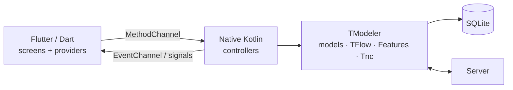

# TModeler with Flutter

> This document complements the [general guide](01-tmodeler.md) and the [native Android guide](02-android.md). It
> repeats neither of them: it explains **how to use TModeler from a Flutter app**.
> Read the general guide first (§1 to §6) and the Android guide (§2 to §6, §10).

## Table of contents

1. [Principle: TModeler lives on the native Android side](#1-principle-tmodeler-lives-on-the-native-android-side)
2. [Environment](#2-environment)
3. [Creating the project](#3-creating-the-project)
4. [Gradle for the `android/` module](#4-gradle-for-the-android-module)
5. [The native Kotlin code](#5-the-native-kotlin-code)
6. [The Dart ↔ Kotlin bridge](#6-the-dart--kotlin-bridge)
7. [Bridge rules](#7-bridge-rules)
8. [The Dart side: providers and screens](#8-the-dart-side-providers-and-screens)
9. [Offline-first with Flutter](#9-offline-first-with-flutter)
10. [Real time and notifications](#10-real-time-and-notifications)
11. [Build, run, publish](#11-build-run-publish)
12. [Flutter troubleshooting](#12-flutter-troubleshooting)
13. [Limitations](#13-limitations)

---

## 1. Principle: TModeler lives on the native Android side

TModeler has no Dart package. The Flutter app is a **native Android app** (the `android/` folder) that embeds
TModeler in Kotlin, plus a Flutter UI. The two talk to each other through **Platform Channels**.



The separation of roles is strict:

| Side | Contains | Never contains |
|---|---|---|
| **Native Kotlin** | models, SQL, `TFlow`, `TFeature`, business rules, `Tnc`, FCM | widgets |
| **Dart / Flutter** | screens, navigation, display state, animations | SQL, business rules, direct server access |

Flutter is a **passive view**: it asks, and the native side answers with data ready to display (DTOs).

> **Why no TModeler in Dart?** The models, the database and the synchronization are already provided by the
> Kotlin library; rewriting them in Dart would duplicate the logic and create two sources of truth.

---

## 2. Environment

To install in addition to what is described in the [Android guide §2](02-android.md#2-environment):

| Tool | Tested version | Note |
|---|---|---|
| **Flutter SDK** | recent stable (Dart ≥ 3.11 for the reference app) | <https://docs.flutter.dev/get-started/install> |
| **Android Studio** | Hedgehog+ with the **Flutter** and **Dart** plugins | Recommended IDE. **VS Code** (Flutter + Dart extensions) also works for Dart; open `android/` in Android Studio for Kotlin |
| JDK | 17 | |
| Gradle / AGP | 8.14 / 8.11 (reference app) | managed by the project wrapper |

Verification:

```powershell
flutter doctor -v       # everything must be checked for Android
flutter devices         # lists emulators and phones
```

> **System disk full (Windows)**: set `PUB_CACHE` (Dart cache), `GRADLE_USER_HOME` (Gradle cache) and
> `TEMP`/`TMP` to another drive before running `flutter`.

---

## 3. Creating the project

```powershell
flutter create --org com.exemple --platforms=android monapp
cd monapp
```

`--platforms=android`: on the Flutter side, TModeler is only used on Android. (iOS: see the [iOS guide](06-ios.md).)

Usual Dart dependencies (`pubspec.yaml`) — none is required by TModeler:

```yaml
dependencies:
  flutter:
    sdk: flutter
  flutter_riverpod: ^2.6.1     # state (your choice: provider, bloc…)
  go_router: ^14.8.1           # navigation (your choice)
```

Run `flutter pub get`, then open the project.

---

## 4. Gradle for the `android/` module

The `android/` module is a regular Android project: follow the [Android guide §4](02-android.md#4-gradle-configuration)
for the dependencies (`co.tamboai:TModeler`, serialization, okhttp, FCM; `co.tamboai:TBridge` is optional, on request) and the
`-Xcontext-receivers` option. Flutter-specific points:

### `android/settings.gradle.kts`

```kotlin
pluginManagement {
    val flutterSdkPath = run {
        val properties = java.util.Properties()
        file("local.properties").inputStream().use { properties.load(it) }
        properties.getProperty("flutter.sdk") ?: error("flutter.sdk not set in local.properties")
    }
    includeBuild("$flutterSdkPath/packages/flutter_tools/gradle")
    repositories { google(); mavenCentral(); gradlePluginPortal() }
}

plugins {
    id("dev.flutter.flutter-plugin-loader") version "1.0.0"
    id("com.android.application") version "8.11.1" apply false
    id("org.jetbrains.kotlin.android") version "2.1.20" apply false
    id("com.google.gms.google-services") version "4.4.2" apply false
}
include(":app")
```

### `android/build.gradle.kts` (root)

```kotlin
allprojects {
    repositories {
        google(); mavenCentral()              // TModeler (co.tamboai) is on Maven Central
        maven("https://jitpack.io")
    }
}
```

### `android/app/build.gradle.kts`

```kotlin
plugins {
    id("com.android.application")
    id("kotlin-android")
    id("dev.flutter.flutter-gradle-plugin")      // AFTER android and kotlin
    id("com.google.gms.google-services")
}

android {
    namespace = "com.exemple.monapp"
    compileSdk = flutter.compileSdkVersion
    defaultConfig {
        applicationId = "com.exemple.monapp"
        minSdk = 23                              // ≥ 21 required by TModeler; Flutter may require more
        targetSdk = flutter.targetSdkVersion
        versionCode = flutter.versionCode
        versionName = flutter.versionName
    }
    compileOptions {
        sourceCompatibility = JavaVersion.VERSION_17
        targetCompatibility = JavaVersion.VERSION_17
    }
    kotlinOptions {
        jvmTarget = "17"
        freeCompilerArgs += "-Xcontext-receivers"
    }
}

flutter { source = "../.." }

dependencies {
    implementation("co.tamboai:TModeler:1.0.1")
    // Optional, on request (contact@tamboai.co); not on Maven Central, the build fails without access:
    // implementation("co.tamboai:TBridge:1.0.1")
    implementation("org.jetbrains.kotlinx:kotlinx-datetime:0.5.0")
    implementation("com.squareup.okhttp3:okhttp:4.12.0")
    implementation(platform("com.google.firebase:firebase-bom:33.7.0"))
    implementation("com.google.firebase:firebase-messaging")
}
```

Place `google-services.json` in `android/app/`.

> **The Kotlin / AGP / Gradle versions** must remain those that `flutter create` generated for your Flutter
> version; do not "modernize" them by hand without reading the Flutter migration notes.

---

## 5. The native Kotlin code

Recommended organization, **one folder per business module**:

```
android/app/src/main/kotlin/com/exemple/monapp/
├── launcher/MonApplication.kt          ← initializes TModeler (Android guide §5)
├── main/MainActivity.kt                ← FlutterActivity + notification click
├── flutterBridge/
│   ├── MonMethodChannel.kt             ← registers each module's channels
│   └── MethodCallArgs.kt               ← argument conversion helpers
├── chats/
│   ├── models/                         ← TModeler models
│   ├── controllers/ChatsController.kt  ← business logic
│   └── flutterBridge/ChatsMethodChannel.kt
└── users/ …
```

### 5.1 `Application`

Identical to the [Android guide §5](02-android.md#5-the-application-class). Declare it in the Manifest:
`android:name=".launcher.MonApplication"`.

### 5.2 Manifest

Identical to the [Android guide §6](02-android.md#6-the-manifest) with, in addition, the elements generated by
Flutter (`flutterEmbedding`, `NormalTheme`, `queries`). Keep `launchMode="singleTop"` on `MainActivity`.

### 5.3 `MainActivity`

```kotlin
class MainActivity : FlutterActivity() {
    override fun configureFlutterEngine(flutterEngine: FlutterEngine) {
        super.configureFlutterEngine(flutterEngine)
        MonMethodChannel.register(flutterEngine)    // registers all channels
        // + notification channel: see §10
    }
}
```

### 5.4 One module = one `MethodChannel`

```kotlin
object ChatsMethodChannel {
    fun register(engine: FlutterEngine) {
        MethodChannel(engine.dartExecutor.binaryMessenger, "com.exemple.monapp/chats")
            .setMethodCallHandler { call, result ->
                when (call.method) {
                    "loadConversations" -> ChatsController.loadConversations { list ->
                        TGate.main { result.success(list.map { it.toMap() }) }    // return on the UI thread
                    }
                    "sendMessage" -> {
                        val id = call.argLong("messagingId")
                        if (id == null) result.error("INVALID_ARGS", "messagingId missing", null)
                        else ChatsController.send(id, call.argument("text")) { result.success(null) }
                    }
                    else -> result.notImplemented()
                }
            }
    }
}
```

Mandatory helper for numbers:

```kotlin
// The Flutter codec encodes small Dart integers as Integer, not Long.
// A direct call.argument<Long>() cast crashes with a ClassCastException.
fun MethodCall.argLong(key: String): Long? = (argument(key) as? Number)?.toLong()
fun MethodCall.argDouble(key: String): Double? = (argument(key) as? Number)?.toDouble()
```

The controller uses `TFlow` and `TFeature` ([general guide §12 and §15](01-tmodeler.md#12-paginated-lists-tflow)).
**The result sent to Dart must be** `Map`, `List`, `String`, numbers, booleans or `null` (the types supported by
the standard codec): never a `TModel`. Convert it (`toMap()`).

---

## 6. The Dart ↔ Kotlin bridge

### 6.1 Dart side: one class per module

```dart
import 'package:flutter/services.dart';

class ChatsBridge {
  static const _channel = MethodChannel('com.exemple.monapp/chats');
  static const _eventsChannel = EventChannel('com.exemple.monapp/chats/events');

  /// Real-time signals: "conversations" or "messages:<id>". No data: "reload that".
  static Stream<String> get eventsStream =>
      _eventsChannel.receiveBroadcastStream().map((e) => e as String);

  static Future<List<ConversationDto>> loadConversations() async {
    final result = await _channel.invokeMethod('loadConversations');
    return (result as List)
        .map((e) => ConversationDto.fromMap(Map<String, dynamic>.from(e as Map)))
        .toList();
  }

  static Future<void> sendMessage(int messagingId, String text) =>
      _channel.invokeMethod('sendMessage', {'messagingId': messagingId, 'text': text});
}
```

### 6.2 `EventChannel`: from native to Dart

```kotlin
EventChannel(engine.dartExecutor.binaryMessenger, "com.exemple.monapp/chats/events")
    .setStreamHandler(object : EventChannel.StreamHandler {
        override fun onListen(args: Any?, events: EventChannel.EventSink?) {
            sink = events
            ChatsController.onConversationsChanged = { TGate.main { sink?.success("conversations") } }
        }
        override fun onCancel(args: Any?) { sink = null }
    })
```

`EventSink.success` must be called **on the main thread** (`TGate.main`).

### 6.3 Errors

On the Kotlin side: `result.error("STABLE_CODE", "readable message", null)`. On the Dart side: `PlatformException`;
test `e.code` (stable) and never the message text.

```dart
try { await UsersBridge.login(id, pwd); }
on PlatformException catch (e) {
  if (e.code == 'INVALID_CREDENTIALS') { /* … */ }
}
```

---

## 7. Bridge rules

These rules prevent 90% of bugs:

1. **No SQL, no business rules in Dart.** Dart calls a verb (`loadConversations`, `sendMessage`).
2. **64-bit identifiers**: on the Dart side, `int` (64-bit) is fine; on the Kotlin side, use `argLong`.
   A server id and a local id are two different things: name them clearly (`messagingId` = local,
   `serverId` = server).
3. **Simple DTOs**: primitive `Map`s; dates as epoch milliseconds (`Long`); enumerations as `String`.
4. **Return on the main thread**: `TGate.main { result.success(…) }`. One single reply per call
   (`success`/`error` called **once**).
5. **Errors with stable codes** (§6.3).
6. **Lists = pages**: the native side keeps a `TFlow` and returns one page on each `loadMore…`. Dart never
   receives "everything".
7. **Media**: Dart sends a local file path (Flutter picker); the native side attaches it to the model.
   To display, the native side returns a local path or a URL.
8. **A signal is not data**: real-time events say "reload resource X"; Dart re-reads.

---

## 8. The Dart side: providers and screens

With Riverpod (your choice): one `StateNotifier` per list, talking to `ChatsBridge`.

```dart
class ConversationsState {
  final List<ConversationDto> items;
  final bool isLoading, hasMore;
  const ConversationsState({this.items = const [], this.isLoading = false, this.hasMore = true});
}

final conversationsProvider =
    StateNotifierProvider.autoDispose<ConversationsNotifier, ConversationsState>(
        (ref) => ConversationsNotifier());
```

Screen:

```dart
class ConversationsScreen extends ConsumerWidget {
  @override
  Widget build(BuildContext context, WidgetRef ref) {
    final s = ref.watch(conversationsProvider);
    if (s.isLoading && s.items.isEmpty) return const ShimmerList();     // skeletons, no full-screen spinner
    return ListView.builder(
      itemCount: s.items.length,
      itemBuilder: (_, i) => ConversationTile(s.items[i]),
    );
  }
}
```

Navigation (go_router): `/chats` then `/chats/:messagingId`; pass the **local** id in the URL.

---

## 9. Offline-first with Flutter

Rule: **opening a screen never waits for the network.** The native side answers with local data; the server only
refreshes.

```dart
class ConversationsNotifier extends StateNotifier<ConversationsState> {
  // In-memory cache: an autoDispose provider is recreated each time the screen is opened;
  // we therefore instantly redisplay the last known content.
  static List<ConversationDto> _cache = const [];
  static void clearCache() => _cache = const [];     // to call on sign-out / account switch

  ConversationsNotifier()
      : super(ConversationsState(items: _cache, isLoading: _cache.isEmpty)) {
    _init();
    _sub = ChatsBridge.eventsStream.listen((e) { if (e == 'conversations') load(); });
  }
  StreamSubscription<String>? _sub;

  Future<void> _init() async {
    await load();                    // 1) local data, immediate
    await _syncInBackground();       // 2) the server, in the background
  }

  Future<void> _syncInBackground() async {
    try { await ChatsBridge.refreshConversations(); } catch (_) { return; }   // offline: ignore
    if (mounted) await load();       // 3) re-reads local data, now up to date
  }

  Future<void> load() async {
    final fresh = await ChatsBridge.loadConversations();       // local read on the native side
    if (!mounted) return;
    _cache = fresh;
    state = ConversationsState(items: fresh, hasMore: fresh.isNotEmpty);
  }

  @override
  void dispose() { _sub?.cancel(); super.dispose(); }
}
```

Points to watch:

- **Never empty the list** during a reload: only show a skeleton when there is **nothing** to display.
- When you re-read the first page, **merge** it with the older pages already loaded to avoid a scroll jump.
- The in-memory cache is **specific to one user**: clear it on sign-out.
- On the native side, `refreshConversations` must not throw a visible exception when the network is absent.
- Test in **airplane mode**: the screen must open with the local data.

---

## 10. Real time and notifications

### 10.1 Real-time signals (WebSocket / FCM → Dart)

The native side (`Tnc`, [general guide §16](01-tmodeler.md#16-instant-notifications-tnc)) receives the signal and
sends it to Dart through the `EventChannel` (§6.2). Dart reloads the indicated resource.

### 10.2 Notification click

Two dedicated channels, `MethodChannel('com.exemple.monapp/notif')`:

| Call | Direction | Usage |
|---|---|---|
| `getInitialNotification` | Dart → native | app **cold-started** by a click: returns the push data (only once) |
| `onNotificationOpened` | native → Dart | app **already open** (foreground or background) |

Kotlin (`MainActivity`):

```kotlin
class MainActivity : FlutterActivity() {
    private var notifChannel: MethodChannel? = null
    private var pending: Map<String, String>? = null

    override fun onCreate(savedInstanceState: Bundle?) {
        super.onCreate(savedInstanceState)
        pending = extract(intent)
    }

    override fun onNewIntent(intent: Intent) {
        super.onNewIntent(intent)
        setIntent(intent)
        val data = extract(intent) ?: return
        pending = data
        notifChannel?.invokeMethod("onNotificationOpened", data, object : MethodChannel.Result {
            override fun success(r: Any?) { pending = null }
            override fun error(c: String, m: String?, d: Any?) {}
            override fun notImplemented() {}
        })
    }

    override fun configureFlutterEngine(engine: FlutterEngine) {
        super.configureFlutterEngine(engine)
        MonMethodChannel.register(engine)
        notifChannel = MethodChannel(engine.dartExecutor.binaryMessenger, "com.exemple.monapp/notif").also {
            it.setMethodCallHandler { call, result ->
                if (call.method == "getInitialNotification") { result.success(pending); pending = null }
                else result.notImplemented()
            }
        }
    }

    private fun extract(intent: Intent?): Map<String, String>? {
        val extras = intent?.extras ?: return null
        if (!extras.containsKey("messagingId")) return null
        val data = extras.keySet().mapNotNull { k -> extras.get(k)?.toString()?.let { k to it } }.toMap()
        intent.removeExtra("messagingId")       // do not replay on every recreation
        return data
    }
}
```

Dart:

```dart
class NotifBridge {
  static const _channel = MethodChannel('com.exemple.monapp/notif');
  static final _opened = StreamController<Map<String, String>>.broadcast();
  static bool _ready = false;

  static Stream<Map<String, String>> get opened { _init(); return _opened.stream; }

  static Future<Map<String, String>?> getInitial() async {
    _init();
    final r = await _channel.invokeMethod('getInitialNotification');
    return r == null ? null : Map<String, String>.from(r as Map);
  }

  static void _init() {
    if (_ready) return;
    _ready = true;
    _channel.setMethodCallHandler((call) async {
      if (call.method == 'onNotificationOpened') {
        _opened.add(Map<String, String>.from(call.arguments as Map));
      }
    });
  }
}
```

At the root of the app, **once the user is signed in and the chat is initialized**:

```dart
final initial = await NotifBridge.getInitial();
if (initial != null) _open(initial);                 // cold start
NotifBridge.opened.listen(_open);                    // app already open

Future<void> _open(Map<String, String> data) async {
  final serverId = int.tryParse(data['messagingId'] ?? '');
  if (serverId == null) return;
  final r = await ChatsBridge.resolveMessaging(serverId);   // server id → local id (+ refreshes if missing)
  if (r != null) router.push('/chats/${r.messagingId}', extra: r.peerName);
}
```

*Dead app* scenario: Android starts the process → `Application.onCreate` (TModeler, current user restored) →
`MainActivity` → Flutter starts → `getInitial()` → navigation. If the user is not signed in, keep the
notification pending and open it after login.

### 10.3 Display permission (Android 13+)

Requested in `MainActivity.onCreate` (see [Android guide §10.2](02-android.md#102-requesting-the-permission-android-13)).

---

## 11. Build, run, publish

### Building TModeler from source (contributors only)

TModeler is on Maven Central, nothing to do for a normal build. To use a local build, see the
[general guide §5.2](01-tmodeler.md#5-installation) (`publishToMavenLocal`) and add `mavenLocal()`.

### Running

```powershell
cd monapp
flutter pub get
flutter run -d <device id>              # debug with hot reload (Dart only; Kotlin requires a restart)
flutter build apk --release             # APK
flutter build appbundle --release       # AAB for the Play Store
```

**Hot reload does not reload Kotlin**: after a native change, run `flutter run` again (hot restart is not
enough).

### Release signing

Configure `signingConfigs` in `android/app/build.gradle.kts` (keystore kept out of the repository) and test the
release APK ([Android guide §12](02-android.md#12-code-shrinking-r8--proguard) for R8).

---

## 12. Flutter troubleshooting

| Symptom | Cause | Solution |
|---|---|---|
| `MissingPluginException` | channel not registered, or Kotlin not recompiled | check `configureFlutterEngine`; run `flutter run` again |
| `ClassCastException Integer cannot be cast to Long` | numeric argument from Dart | `argLong` / `argDouble` (§5.4) |
| `Reply already submitted` | `result.success` called twice | one single reply per call |
| "not on main thread" crash on `EventSink` | `success()` outside the UI thread | `TGate.main { … }` |
| Empty list on first display although the native side has data | `load()` launched on an `autoDispose` provider not yet observed | start loading in the notifier's constructor |
| Data from another account displayed | in-memory cache not cleared | `clearCache()` on sign-out |
| Kotlin changes have no effect | hot reload | stop and relaunch the app |
| `Could not resolve co.tamboai:TModeler` | `mavenCentral()` missing | add `mavenCentral()` in `android/build.gradle.kts` (§4) |
| `Context receivers are not enabled` | Kotlin option missing | §4 |
| Notification click: app opens but not the right conversation | `getInitial` called too early, or intent not consumed | §10.2: call it after login; `singleTop` + `onNewIntent` |
| Slow build / out-of-disk-space failure | caches on C: | `PUB_CACHE`, `GRADLE_USER_HOME` (§2) |
| `flutter doctor`: Android licenses | licenses not accepted | `flutter doctor --android-licenses` |

---

## 13. Limitations

- In Flutter, TModeler can only be used on **native Android**; there is no Dart package.
- Flutter on iOS would require an equivalent Swift bridge: see the [iOS guide](06-ios.md).
- Flutter Web/Desktop: not covered (for the web, see the [React guide](04-react.md), which uses Kotlin/Wasm).
- Each new feature = one bridge verb (Dart) + one controller (Kotlin); keep the logic on the native side.
