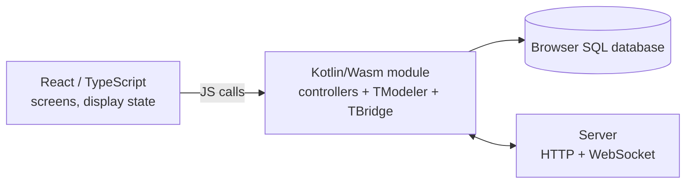

# TModeler with React (Web)

> This document complements the [general guide](01-tmodeler.md). It explains **how to use TModeler in a React
> web application**. Read the general guide first (§1 to §6, §14 to §16 and §19).
> For the mobile counterpart, see the [Flutter guide](03-flutter.md): the philosophy (passive UI, logic in
> TModeler) is the same.

## Table of contents

1. [Principle: TModeler compiled to WebAssembly](#1-principle-tmodeler-compiled-to-webassembly)
2. [Environment](#2-environment)
3. [Project structure](#3-project-structure)
4. [The Kotlin/Wasm module](#4-the-kotlinwasm-module)
5. [Defining models for the web](#5-defining-models-for-the-web)
6. [Initializing TModeler in the browser](#6-initializing-tmodeler-in-the-browser)
7. [The `@JsExport` export contract](#7-the-jsexport-export-contract)
8. [Building the library](#8-building-the-library)
9. [The React / Vite application](#9-the-react--vite-application)
10. [The TypeScript bridge](#10-the-typescript-bridge)
11. [Offline-first in the browser](#11-offline-first-in-the-browser)
12. [Real time and push notifications (Web Push)](#12-real-time-and-push-notifications-web-push)
13. [Files and media](#13-files-and-media)
14. [Deployment](#14-deployment)
15. [React / Wasm troubleshooting](#15-react--wasm-troubleshooting)
16. [Web limitations](#16-web-limitations)

---

## 1. Principle: TModeler compiled to WebAssembly

The TModeler library is compiled for the browser with **Kotlin/Wasm** (the `wasmJs` target). Your web app is
therefore made of **two parts**:



| Side | Contains | Never contains |
|---|---|---|
| **Kotlin/Wasm module** | models, SQL, `TFlow`, `TFeature`, business rules, server calls, `Tnc` | React components |
| **React / TypeScript** | screens, routes, UI state, accessibility | SQL, business rules, direct access to the data server |

React receives **already-resolved JSON** and renders it; it does not rebuild the data graph.

---

## 2. Environment

| Tool | Tested version | Note |
|---|---|---|
| **IntelliJ IDEA** (Community is enough) | recent, **Kotlin** plugin | IDE for the Kotlin/Wasm module |
| **VS Code** (or WebStorm) | recent | IDE for React / TypeScript |
| JDK | 17 or 21 | for Gradle |
| Gradle | project wrapper | |
| Kotlin | **1.9.23** (+ KSP `1.9.23-1.0.20`) | version tested with TModeler web |
| Node.js | 20 LTS or later | npm |
| Browser | Chrome / Edge ≥ 119, Firefox ≥ 120, Safari ≥ 18.2 | **WasmGC** required |
| React / Vite / TypeScript | 18.3 / 6 / 5.6 | |

> The browser must support **WebAssembly GC** and Wasm *exception handling*. An older browser
> will fail to load the `.wasm`: display a clear message in that case.

System disk full (Windows): set `GRADLE_USER_HOME`, `TEMP`, `TMP` and the npm cache
(`npm config set cache D:\tmp\npm-cache`) to another drive.

---

## 3. Project structure

```
my-web-app/
├── app/                           ← Kotlin/Wasm module (Gradle)
│   ├── build.gradle.kts
│   └── src/
│       ├── commonMain/kotlin/…    ← models, features, controllers, @JsExport bridge
│       └── wasmJsTest/kotlin/…    ← browser tests (Karma)
├── settings.gradle.kts            ← include(":app")
├── gradle.properties
├── package.json                   ← React app
├── vite.config.ts
├── public/                        ← .wasm copied here + tnc-sw.js
└── src/                           ← React + TypeScript
    └── features/chats/bridge/     ← TS ↔ Kotlin/Wasm bridge
```

`settings.gradle.kts`:

```kotlin
pluginManagement { repositories { gradlePluginPortal(); google(); mavenCentral() } }
dependencyResolutionManagement { repositories { google(); mavenCentral() } }
rootProject.name = "my-web-app"
include(":app")
```

---

## 4. The Kotlin/Wasm module

`app/build.gradle.kts`:

```kotlin
plugins {
    kotlin("multiplatform") version "1.9.23"
    id("com.google.devtools.ksp") version "1.9.23-1.0.20"
}

kotlin {
    compilerOptions { freeCompilerArgs.add("-Xcontext-receivers") }     // REQUIRED

    wasmJs {
        binaries.library()                       // produces a library reusable by npm
        browser { testTask { useKarma { useChromeHeadless() } } }
    }

    sourceSets {
        val commonMain by getting {
            dependencies {
                implementation("co.tamboai:TModeler:1.0.1")
                // Optional, on request (contact@tamboai.co); not on Maven Central, the build fails without access:
                // implementation("co.tamboai:TBridge:1.0.1")       // synchronization + Tnc
                implementation("org.jetbrains.kotlinx:kotlinx-serialization-json:1.6.3")
                implementation("org.jetbrains.kotlinx:kotlinx-datetime:0.5.0")
                implementation("org.jetbrains.kotlinx:kotlinx-coroutines-core:1.8.1")
            }
        }
        val commonTest by getting { dependencies { implementation(kotlin("test")) } }
    }
}

// The web has no reflection: a model registry is GENERATED at compile time (KSP)
ksp { arg("tmodeler.registryPackage", "com.exemple.monapp.generated") }
dependencies { add("kspWasmJs", "co.tamboai:tmodeler-ksp:1.0.1") }

repositories { google(); mavenCentral() }
```

Why KSP? Kotlin/Wasm does not support the reflection that TModeler uses on JVM/Android. The `tmodeler-ksp`
processor generates, at compile time, a **registry** of your models (the `registerAllTModels()` function) in the
package given by `tmodeler.registryPackage`.

---

## 5. Defining models for the web

Models are written as in the [general guide §7](01-tmodeler.md#7-defining-models), with a few
additional web-specific rules:

| Rule | Detail |
|---|---|
| No-argument constructor | `class Message : TModel<Message>()` |
| **Public** and **non-null** fields | `var content = TextField()` — no `private`, no nullable type |
| No generics on the model | a generic model is not detected by the registry |
| A `companion object` with `val tms by lazy { Tms(X::class) }` | as on Android |
| `xxx_` delegates annotated `@TMignore` | as on Android |

Example (identical to Android):

```kotlin
class Message : TModel<Message>() {
    var messaging = ModelField(Messaging::class)
    var content   = TextField()
    var medias    = ListField(Media::class)

    @TMignore var messaging_ by messaging
    @TMignore var content_   by content
    @TMignore var medias_    by medias

    companion object { val tms by lazy { Tms(Message::class) } }
    override fun onSync() = super.onSync()?.with("ChatApp_message", "chats/messages/", null)
}
```

Tip: **share the model code with Android** by placing it in a common KMP module if you
develop for both platforms.

---

## 6. Initializing TModeler in the browser

Differences from Android ([Android guide §5](02-android.md#5-the-application-class)):

- **No `.context(...)`**, no `.dbDir(...)`: the database lives in the browser.
- No `.accept(package)`: the generated registry (`registerAllTModels()`) replaces reflection-based discovery.
- The push configuration is of the **web** type (`fcm { web { … } }`).

```kotlin
import com.exemple.monapp.generated.registerAllTModels

fun initTModeler(dbName: String, serverHost: String, wsHost: String, push: PushWebConfig?): Boolean {
    registerAllTModels()                                   // BEFORE any use of a model

    val config = TServerConfig()
        .baseServerHost(serverHost)
        .baseServerMediaHost("media")
        .autoSync(false)

    TModeler.start()
        .synchronization(TBridge.start())
        .notifications {
            websocket { url(wsHost) }
            if (push != null) fcm {
                web {
                    apiKey(push.apiKey); projectId(push.projectId)
                    messagingSenderId(push.senderId); appId(push.appId); vapidKey(push.vapidKey)
                }
                accept { data -> data["type"] == "message" }
                onOpen { data -> /* click on a notification: see §12 */ }
            }
        }
        .connect(
            Tdb.Builder().type(Tdb.Type.SQLITE).dbName(dbName).server(config).start()!!
        )

    Message.tms.commit()                                   // creates the tables
    Messaging.tms.commit()
    return true
}
```

> The exact names of some parameters (`url`, `web { … }`, `onOpen`) follow the `Tnc` configuration
> described in the [general guide §16](01-tmodeler.md#16-instant-notifications-tnc).

---

## 7. The `@JsExport` export contract

Kotlin/Wasm 1.9 allows `@JsExport` **only on top-level functions** (not on classes or objects).
The contract between React and Kotlin is therefore a **set of prefixed functions** (here `chatBridge…`).

```kotlin
@OptIn(ExperimentalJsExport::class)
@JsExport
@JsName("chatBridgeInitOnline")
fun chatBridgeInitOnline(dbName: String, serverHost: String, wsHost: String, pushConfigJson: String): Boolean =
    initTModeler(dbName, serverHost, wsHost, parsePush(pushConfigJson))

@OptIn(ExperimentalJsExport::class)
@JsExport
@JsName("chatBridgeOpenConversations")
fun chatBridgeOpenConversations(cb: (String) -> Unit) {
    ChatsController.openConversations { list -> cb(Json.encodeToString(list)) }    // JSON → React
}

@OptIn(ExperimentalJsExport::class)
@JsExport
@JsName("chatBridgeSendMessage")
fun chatBridgeSendMessage(messagingId: Double, text: String, cb: (String) -> Unit) { /* … */ }
```

Contract design rules:

| Rule | Why |
|---|---|
| **Simple input types**: `String`, `Boolean`, `Double`/`Int`, callback functions | the only types that are safe across the JS ↔ Wasm boundary |
| **Output as JSON (`String`)** | a graph of Kotlin objects cannot be used on the JS side |
| **Asynchronous via callback** `cb: (String) -> Unit` | the browser has no blocking thread; the callback receives the JSON |
| **Error = JSON `{"error":"STABLE_CODE"}`** | React tests the code, never the text |
| **64-bit identifiers** | a `Long` does not cross into JS without loss: pass ids as `Double` (up to 2⁵³) or as `String` |
| **Events**: `chatBridgeSubscribe(cb)` | the core pushes `"conversations"`, `"messages:<id>"`, `"ws:open"`, `"ws:closed"`, `"open:<serverId>"` |

And the **TypeScript declarations** file (`tmchat_core_web.d.ts`) describes these functions:

```ts
declare module 'tmchat-core-web/tmchat-app-web-wasm-js.mjs' {
  export interface TmChatCoreWeb {
    chatBridgeInitOnline(dbName: string, serverHost: string, wsHost: string, pushConfigJson: string): boolean;
    chatBridgeOpenConversations(cb: (json: string) => void): void;
    chatBridgeSendMessage(messagingId: number, text: string, cb: (json: string) => void): void;
    chatBridgeSubscribe(cb: (event: string) => void): void;
  }
  const core: TmChatCoreWeb;
  export default core;
}
```

---

## 8. Building the library

### 8.1 Getting TModeler

`co.tamboai:TModeler-wasm-js` and `co.tamboai:tmodeler-ksp` are on Maven Central: nothing to publish. To use a
local build of TModeler instead, see the [general guide §5.2](01-tmodeler.md#5-installation)
(`publishToMavenLocal`) and add `mavenLocal()` to the repositories above.

### 8.2 Compiling the module

```powershell
.\gradlew.bat -p app wasmJsBrowserProductionLibraryDistribution
```

Output: `app/build/dist/wasmJs/productionLibrary/` containing

```
package.json                      ← local npm package
tmchat-app-web-wasm-js.mjs        ← JS entry point (imported by React)
tmchat-app-web-wasm-js.wasm       ← the Wasm code (~3 MB)
tmchat-app-web-wasm-js.d.ts / .map
```

Tests in a real browser (headless Chrome):

```powershell
.\gradlew.bat -p app wasmJsBrowserTest
```

---

## 9. The React / Vite application

### 9.1 `package.json`

```json
{
  "type": "module",
  "scripts": {
    "dev": "vite",
    "build": "npm run sync:wasm && tsc -b && vite build",
    "preview": "vite preview",
    "sync:wasm": "node -e \"require('fs').copyFileSync('app/build/dist/wasmJs/productionLibrary/monapp-wasm-js.wasm','public/monapp-wasm-js.wasm')\"",
    "sync:sw": "node -e \"require('fs').copyFileSync(process.env.TMODELER_SW,'public/tnc-sw.js')\""
  },
  "dependencies": {
    "react": "^18.3.1",
    "react-dom": "^18.3.1",
    "react-router-dom": "^6.27.0",
    "monapp-core-web": "file:./app/build/dist/wasmJs/productionLibrary"
  }
}
```

The `file:` dependency points to the Gradle output: **every Kotlin recompilation updates the lib** after
`npm install` (or a new link). The package name in `dependencies` is the one you use in
`import` statements. Adapt `monapp-wasm-js` to the actual module name (Gradle project name + `-wasm-js`).

```powershell
npm install
```

### 9.2 `vite.config.ts` (essentials)

```ts
import { defineConfig } from 'vite'
import react from '@vitejs/plugin-react'

export default defineConfig({
  plugins: [react()],

  // Server without CORS headers: same-origin relay (dev AND preview)
  server:  { proxy: { '/api': { target: 'https://api.example.com', changeOrigin: true, secure: true,
                                rewrite: (p) => p.replace(/^\/api/, '') } } },
  preview: { proxy: { '/api': { target: 'https://api.example.com', changeOrigin: true, secure: true,
                                rewrite: (p) => p.replace(/^\/api/, '') } } },

  // The Kotlin/Wasm lib uses top-level await: no pre-bundling, esnext target
  optimizeDeps: { exclude: ['monapp-core-web'], esbuildOptions: { target: 'esnext' } },
  build: { target: 'esnext' },
})
```

| Setting | Why |
|---|---|
| `optimizeDeps.exclude` | Vite must not re-bundle the Wasm lib |
| `target: 'esnext'` | *top-level await* in the generated `.mjs` |
| proxy | a browser **blocks** requests to a server without CORS; the proxy makes them same-origin. Recommended alternative in production: enable CORS on the server ([guide §18](01-tmodeler.md#18-server-side-python--django)) or serve the front end and the API under the same domain |
| The WebSocket | is **not** subject to CORS: direct connection (`wss://`) |

### 9.3 Environment variables (`.env.local`)

```
VITE_APP_SERVER=https://monsite.example.com/api
VITE_APP_WS=wss://api.example.com
# Web Push (optional): values from the WEB app of the Firebase project
VITE_FIREBASE_API_KEY=…
VITE_FIREBASE_PROJECT_ID=…
VITE_FIREBASE_SENDER_ID=…
VITE_FIREBASE_APP_ID=…
VITE_FIREBASE_VAPID_KEY=…
```

Do not commit `.env.local`. `VITE_*` variables are **visible to everyone** in the bundle: never put a server
secret in them.

### 9.4 Running

```powershell
npm run dev            # development (http://localhost:5173)
npm run build          # production → dist/
npm run preview        # serves dist/ (http://localhost:4173)
```

---

## 10. The TypeScript bridge

A **single TS module** talks to the Wasm core; the rest of the React app imports only this module.

### 10.1 Interface (what React knows)

```ts
export interface IChatsBridge {
  init(): Promise<boolean>
  login(id: string, pwd: string): Promise<UserDto>
  openConversations(): Promise<Page<ConversationDto>>
  loadMoreConversations(): Promise<Page<ConversationDto>>
  refreshConversations(): Promise<void>
  openMessages(messagingId: number): Promise<Page<MessageDto>>
  sendMessage(messagingId: number, text: string): Promise<void>
  subscribe(listener: (event: string, payload?: any) => void): () => void
}
```

### 10.2 Implementation: module loading + callbacks → promises

```ts
import type { TmChatCoreWeb } from 'monapp-core-web/monapp-wasm-js.mjs'

class ChatsBridgeOnline implements IChatsBridge {
  private core: TmChatCoreWeb | null = null
  private initPromise: Promise<boolean> | null = null

  init() {
    if (!this.initPromise) this.initPromise = this.load().catch((e) => { this.initPromise = null; throw e })
    return this.initPromise
  }

  private async load() {
    const mod = await import('monapp-core-web/monapp-wasm-js.mjs')      // dynamic import: the .wasm loads here
    const core = (mod.default ?? mod) as TmChatCoreWeb
    if (!core.chatBridgeInitOnline('monapp_db', serverHost(), realtimeHost(), pushConfig()))
      throw new Error('Unable to initialize the TModeler engine')
    core.chatBridgeSubscribe((event) => this.onCoreEvent(event))
    this.core = core
    return true
  }

  // Turns a "JSON callback" API into a promise
  private call<T>(start: (cb: (json: string) => void) => void): Promise<T> {
    return new Promise((resolve, reject) => {
      try {
        start((json) => {
          const v = JSON.parse(json)
          if (v && !Array.isArray(v) && typeof v.error === 'string') reject(new Error(v.error))
          else resolve(v as T)
        })
      } catch (e) { reject(e) }
    })
  }

  async openConversations() {
    await this.init()
    return this.call<Page<ConversationDto>>((cb) => this.core!.chatBridgeOpenConversations(cb))
  }
}
export const chatsBridge = new ChatsBridgeOnline()
```

### 10.3 One module, several implementations

Keep `IChatsBridge` as an interface. This lets you have a **mock** implementation (in-memory data)
to develop screens without the Wasm, and the real implementation for production.

---

## 11. Offline-first in the browser

Same rule as on mobile ([Flutter guide §9](03-flutter.md#9-offline-first-with-flutter)): **opening a screen
shows local data first**, then refreshes in the background.

In the Kotlin core: `openConversations` / `openMessages` **read the local database and respond immediately**;
`refreshConversations` / `refreshMessages` query the server and then save locally.

In React:

```tsx
function useConversations() {
  const [items, setItems] = useState<ConversationDto[]>(cache)          // module cache = last known content
  const [loading, setLoading] = useState(cache.length === 0)

  useEffect(() => {
    let alive = true
    const reload = async () => {
      const page = await chatsBridge.openConversations()                // 1) local, immediate
      if (alive) { cache = page.items; setItems(page.items); setLoading(false) }
    }
    reload().then(() => chatsBridge.refreshConversations()).then(reload).catch(() => {})   // 2) server, then 3) re-read
    const off = chatsBridge.subscribe((e) => { if (e === 'conversations') reload() })
    return () => { alive = false; off() }
  }, [])

  return { items, loading }
}
```

- A **skeleton** (shimmer) only if there is nothing to display; never an emptied list during a reload.
- Clear `cache` on logout / account change.
- **Persistence**: the browser database survives a page reload; the reopened app therefore displays its
  local data, even offline.
- Test: DevTools ▸ Network ▸ *Offline*, then reload the page.

---

## 12. Real time and push notifications (Web Push)

### 12.1 WebSocket

No React configuration needed: `chatBridgeInitOnline` receives the `wss://…` host. The core emits `ws:open` /
`ws:closed` and the `conversations` / `messages:<id>` signals via `chatBridgeSubscribe`. Plan for a **fallback
polling** (for example every 10 s, disabled while the WebSocket is open).

### 12.2 Web Push (FCM)

1. Firebase Console ▸ **Add a Web app**: note `apiKey`, `projectId`, `messagingSenderId`, `appId`.
2. Project settings ▸ *Cloud Messaging* ▸ **Web Push certificates**: generate the **VAPID** key.
3. Fill in the `VITE_FIREBASE_*` variables (§9.3).
4. Copy the **service worker** `tnc-sw.js` shipped with the lib (`shared/src/wasmJsMain/resources/tnc-sw.js` in
   the TModeler sources) into `public/` (it must be served **at the root** of the site):

   ```powershell
   $env:TMODELER_SW = "<path>\tnc-sw.js"; npm run sync:sw
   ```
5. The core (`Tnc`) registers the service worker, requests the browser permission and sends the token to the
   server. Without the five values, only the WebSocket is active (no error).

Web Push constraints:

- **HTTPS required** (except on `localhost`).
- The permission must be granted by the user; Safari/iOS requires the site to be **installed on the
  home screen**.
- The service worker displays pushes **when the tab is not visible**; when the tab is visible, the WebSocket is enough.

### 12.3 Clicking a notification

The click brings the user back to the tab and triggers the `onOpen` callback configured in §6, which emits the
`open:<serverId>` event to React. Listen for it and navigate:

```ts
chatsBridge.subscribe((event, payload) => {
  if (event === 'open') navigate(`/chats/by-server/${payload}`)   // resolves the server id → local conversation
})
```

If the user is not logged in, remember the id and open the conversation after login.

---

## 13. Files and media

- The browser has no file system: TModeler uses an **in-memory virtual `TFile`**, with
  persistence in `localStorage` **limited to ≈ 256 KiB**.
- **Upload**: React reads the `File`/`Blob`, encodes it in **chunks** (e.g. 1 MiB, in base64) and calls
  `chatBridgeStageFile(path, base64, append)` for each chunk; then `chatBridgeSendOnlineMedias(...)`; if the
  user cancels, `chatBridgeDiscardFile(path)`.
- **Display**: a media item that was just sent is not served yet: display a local URL
  (`URL.createObjectURL`) until the server has validated it.
- For large media, do not rely on local persistence: the server remains the source of truth.

---

## 14. Deployment

1. `npm run build` → `dist/` folder (HTML, JS, `.wasm`, `tnc-sw.js`).
2. Serve `dist/` over **HTTPS** with:
   - `Content-Type: application/wasm` for `.wasm` files (most servers already do this);
   - an SPA *fallback* to `index.html` for React routes;
   - `tnc-sw.js` at the root, `Service-Worker-Allowed` is unnecessary at the root;
   - gzip/brotli compression (the `.wasm` goes from ~3 MB to ~1 MB).
3. **Data server**: enable CORS for the site's origin **or** expose the API under the same domain
   (reverse proxy `/api` → server). The Vite proxy only exists in development/preview.
4. Add the site's origin to the Django server's `ALLOWED_HOSTS` / `CSRF_TRUSTED_ORIGINS` if needed.

Nginx example:

```nginx
location /api/ { proxy_pass https://api.example.com/; proxy_set_header Host api.example.com; }
location / { try_files $uri /index.html; }
```

---

## 15. React / Wasm troubleshooting

| Symptom | Cause | Solution |
|---|---|---|
| `CompileError: WebAssembly.instantiate` | browser without WasmGC | update the browser (§2) |
| `Top-level await is not available` at build time | JS target too old | `build.target: 'esnext'` (§9.2) |
| The module loads, then `Failed to fetch … .wasm` | `.wasm` missing from `public/` | `npm run sync:wasm`; check the file name |
| `Failed to resolve import "xxx-core-web"` | `npm install` not run after the Gradle build | Gradle build, then `npm install` |
| Vite re-bundles the lib and breaks it | `optimizeDeps.exclude` missing | §9.2 |
| `CORS policy: No 'Access-Control-Allow-Origin'` | server without CORS | proxy (dev) / CORS or same domain (prod) |
| "Unknown" model / missing table | `registerAllTModels()` not called, or wrong KSP package | call it **before** any model; check `tmodeler.registryPackage` |
| Model not detected | private / nullable field / constructor with arguments / generic | rules in §5 |
| `JsExport`: compilation error | `@JsExport` on a class or an object | top-level functions only (§7) |
| Wrong / truncated ids on the React side | 64-bit `Long` | pass as `Double` ≤ 2⁵³ or `String` |
| SQL query fails (`JOIN`, `GROUP BY`…) | limited wasm SQL engine | filter/aggregate on the Kotlin side (see §16) |
| No push notification | `VITE_FIREBASE_*` variables missing, HTTP, permission denied, SW missing | §12.2 |
| `tnc-sw.js` 404 | not served at the root | copy it into `public/` |
| Kotlin changes do not appear | old lib in cache | recompile, `npm install`, restart `vite` (clear the browser cache) |
| The page freezes for a long time on first load | uncompressed `.wasm` | enable gzip/brotli; load the module behind a waiting screen |

---

## 16. Web limitations

- **SQL**: the browser's SQL engine does not run `JOIN`, `GROUP BY` or `HAVING`. Use TModeler
  relations ([guide §9](01-tmodeler.md#9-relations)) and filter on the Kotlin side.
- **Files**: virtual `TFile`, persistence ≤ 256 KiB.
- **Web Push**: HTTPS, user permission, installation required on iOS.
- **Spatial** (SpatiaLite): not available.
- **Schema migration**: `migrate()` backs up, empties, then recreates the table; plan a versioning
  strategy for the browser database.
- **Multiple tabs**: the behavior of two tabs open on the same database has not been validated; test this
  case if your app allows it.
- **Size**: ~3 MB of `.wasm` (≈ 1 MB compressed).
